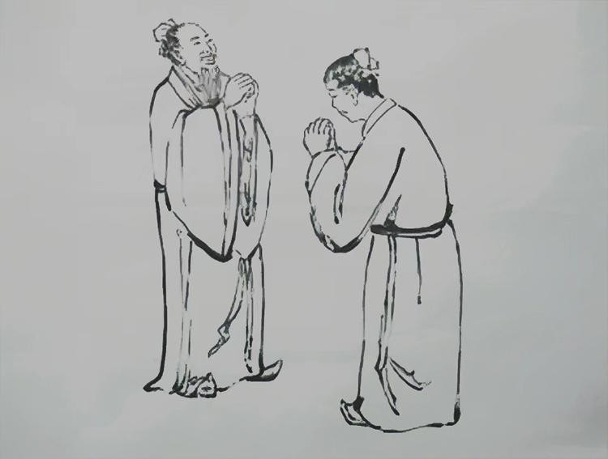

When I used to read this line from the Xunzi: "Li is that by which noble and base have their grades, old and young their distinctions, and poor and rich, light and heavy, each their due measure,"
and the opening of Sima Guang's Comprehensive Mirror for Aid in Government: "Of the duties of the Son of Heaven, none is greater than li; of li, none is greater than distinctions; of distinctions, none is greater than names,"
my first reaction was: stuffy formalism!!
Noble and base in grades, old and young in distinctions, the order of names and standing: it all sounded just like the old system of hierarchical rules.

But after I started working, coordinating and cooperating with all kinds of people and handling relationships, I slowly realized
there's a reason li has lasted so long.
Li isn't about making you behave, or about suppressing yourself, nor about moving the ancient hierarchy of rank wholesale into the present day.

The problem li really deals with is very concrete:
when a group of people need to cooperate, how do you keep every interaction from having to start over with guessing, defending and testing?

At the metro station, you naturally queue.
In the library, you lower your voice.
Writing to a stranger, you address them first.
When you quote someone's idea, you cite the source.
In a meeting room, you wait for the chair to open.
All of these are li.

They look like small gestures, but each one sends a signal of confirmation:
I see you, I know there are rules here, I won't suddenly attack you,
we're now entering a state in which we can cooperate.

Without these signals, people have to stay on guard in their interactions, and that's what makes it exhausting.
Because you keep having to guess: guess whether the other person is hostile, guess whether you've been seen,
guess whether this can be said, guess who has the right to decide, guess whether someone will cross the line.

So the essence of li is a protocol for social interaction that reduces internal friction.

The Comprehensive Mirror says: "Of li, none is greater than distinctions; of distinctions, none is greater than names."
"Distinctions" here are each person's position and responsibility in a relationship.
"Names" are titles, roles and identities.
Whether a group can cooperate depends on whether everyone knows
who is who; who is where;
who should do what; who has the right to decide; who must not be crossed.

Humans are social animals.
Wherever there's a group, there are positions.
Wherever there are positions, there is a sense of what's appropriate.
Only where there's a sense of what's appropriate can there be trust.
Only where there's trust does cooperation not have to start from zero every time.

In Zi Wei Dou Shu, many stars are actually dealing with the order behind li. For example:

✽ The Emperor (Zi Wei), core quality zun (dignity)
The Emperor deals with dignity and position.
Zun isn't being high and mighty. It deals with:
In this relationship, am I seen? Am I recognized?
Am I placed in a position that matches my weight?

The first act of li is confirming positions.

In a meeting, if no one knows who's chairing and who makes the final call, people start talking over each other, waiting and seeing, and passing the buck.
In a partnership, if it isn't confirmed who represents the team, who's authorized to negotiate externally and who can decide, problems are bound to come later.
So the question the Emperor deals with is:
is everyone clear about who is in which position?
When the Emperor is mature, it can stabilize the leading position, so others don't have to work hard to guess;
it knows where it should stand, and lets others know what it's willing to take responsibility for.

When the Emperor is out of balance, it turns into status anxiety.
They didn't ask me first; does that mean they don't respect me?
My opinion wasn't adopted; does that mean they don't take me seriously?
I clearly carry weight, so why haven't I been put in the right position?
This is the reaction when zun is damaged.
So the Emperor's li is the li of position.
What it cares about is: in the group, do I have a position where my dignity can rest?

✽ The Star of Restraint (Lian Zhen), core quality qiu (confinement)
The Star of Restraint deals with boundaries and what is appropriate.
Qiu is a frame, a boundary, a sense of what's appropriate, and also a norm.
Li not only confirms where you are, but also confirms that I won't "cross over."
What can be said? What shouldn't be meddled in? Where does responsibility end?
At what degree of closeness does a relationship start to become an intrusion?
These are all the order the Star of Restraint deals with.

Modern li increasingly deals with this:
forwarding someone's private messages without consent is a breach of li;
using someone's idea without crediting them is a breach of li;
treating "we're close" as a reason to take without limit is a breach of li;
stepping into someone's life in the name of "I'm doing it for your own good" is also a breach of li.
And this kind of breach is especially hard to point out, because it often wears the cloak of caring.

The question the Star of Restraint deals with is:
are we both clear about where the line between you and me is?

When the Star of Restraint is mature, a person knows what is appropriate.
Coming close without intruding. Stepping back without being cold.
Caring without controlling. Helping without overstepping.
When the Star of Restraint is out of balance, two states appear.
One is too tight: any closeness feels like an intrusion, any reminder feels like control.

The other is too loose:
no boundaries, treating familiarity as a free pass, treating the relationship as something to take from, treating goodwill as a given.
So the Star of Restraint's li is the li of what is appropriate.
What it cares about is: can we come close without intruding on each other?

✽ The Sun (Tai Yang), core quality gui (esteem)
The Sun deals with guidance in public view.
The Sun's gui isn't only about being seen.
It's shining, illuminating, guiding and taking responsibility in the public sphere, letting everyone know where the direction is and where the standard is.
One function of li is to let the direction be stated clearly.

What are we discussing today? What's the goal? What are the criteria for judging?
If something goes wrong, who steps forward? Where should everyone head?
If no one in a setting makes these clear, everyone will guess on their own and go their own way, and in the end no one knows what actually happened.
This is the Sun.

The question the Sun deals with is:
is anyone willing to stand up and make the direction and standards clear?
When the Sun is mature, it is willing to let everyone see: I explain, I take responsibility, I make the direction clear, I let the standards be seen.

When the Sun is out of balance, two states also appear.
One is demanding obedience in the name of "I'm doing this for everyone's good."
The other is putting oneself too much into public responsibility, being drained for a long time without realizing that one also needs to be looked after.

Both states come from the same root: being too used to "I'll be the light," and forgetting that illuminating also needs boundaries.
So the Sun's li is the li of the public view.
What it cares about is: who is willing to make the direction clear and take responsibility in public?

✽ The Chancellor (Tian Fu), core quality quan (control)
The Chancellor deals with weighing, allocating and keeping the situation under control.
Quan isn't only control.
The Chancellor's quan is coordinating, allocating, taking on and wrapping things up: the force that puts resources in their proper places and keeps the situation from spinning out of control.
The Chancellor carries the meaning of "the emperor's deputy" and "the senior minister who guards the state."
It's the one who lets everything behind it run steadily.
If the Emperor asks: who carries weight? And the Keeper of the Seal asks: who has recognized standing and authority?
Then the Chancellor asks:
how should this situation be arranged so it doesn't get out of control? How should resources be allocated? How is responsibility taken on? How are conflicts brought to a close? How will things be maintained afterward?

Why does li need the Chancellor?
Because li can't stop at rules.

A gathering has a seating order, but someone still has to arrange the food, the timing, the atmosphere and the social niceties.
A meeting has a chair, but someone still has to manage the pace, allocate speaking time and wrap up the conclusions.
A partnership has recognized standing and roles, but there are many gray areas not written into the contract that need someone to judge, coordinate and leave room.

Li provides the rules of interaction.
What the Chancellor deals with is how these rules are controlled and judged in real situations.
So the Chancellor's li isn't forms of address, ceremonies or recognized standing; that leans more toward the Keeper of the Seal.
The Chancellor's li is the li of governing the situation.
What it cares about is: can the cooperation hold its basic ground?
Have resources been reasonably arranged? Is anyone taking on the gaps in responsibility?
Is anyone taking favors, interests, emotions and consequences into account together?
When the Chancellor is mature, li isn't just surface rules, but becomes an order that lets everyone cooperate with peace of mind.

Someone arranges the resources, someone takes on the responsibility, someone brings the situation to a close.
Someone leaves the room that should be left; someone deals with the consequences that need dealing with.

When the Chancellor is out of balance, it turns into control:
everything must be brought under its control,
everything must be arranged its way.
On the surface it's maintaining order; in reality it leaves others no room.

So the relationship between the Chancellor and li is:
li lets people know how to interact;
the Chancellor keeps this interaction from falling apart under the pressures of reality.

✽ The Keeper of the Seal (Tian Xiang), core quality yin (the Seal)
The Keeper of the Seal deals with recognized standing, authorization and institutional recognition.
Yin, the Seal, is authorization, recognized standing, a formal basis.
Tian Xiang is the star that governs ranks, in the position of assisting the emperor.
What it deals with is:
is this relationship properly established?
Does what this person says have a basis?
Is this role recognized?
Has this matter been formally authorized?

When you address someone as "Teacher," "Doctor," "Director" or "the officer in charge," it isn't just politeness; it's confirming the protocol of interaction.
The form of address you use is like confirming the format of the relationship in advance.
The same sentence is said differently to a teacher, a friend, a superior or a child, because when the recognized standing differs, the protocol of interaction differs.
Imagine a scene.
Someone says, "Let's discuss the direction of this matter."
If they're your manager, you'll listen carefully;
if they're just a colleague from the department next door, you might first think: um, is this their call to make?

The same sentence has a completely different effect depending on whether the recognized standing has been confirmed.
This is the Keeper of the Seal.

The question the Keeper of the Seal deals with is:
has this relationship been formally confirmed?
Is this position authorized?
Does this process have a basis?
Is this person qualified to represent?
When the Keeper of the Seal is mature, it makes relationships properly established:
clear authorization, clear processes, clear responsibilities, clear roles.

When the Keeper of the Seal is out of balance, it turns into formalism:
too focused on procedure, too focused on surface standing,
too focused on whether one has been formally recognized.
Things that could clearly be handled get stuck on "Is this compliant?" "Does this have proper standing?"

But if there were no Keeper of the Seal at all, relationships would lose their basis too.
People would start guessing: Who are you to say so?
What do I count for? Who has the final say on this?
Who has the right to represent? Who's responsible?

So the Keeper of the Seal's li is the li of recognized standing.
What it cares about is: does this interaction have a recognized format for the relationship?

-------
People live in relationships, so they need li.
Ancient li often dealt with rank.
Modern li deals more with boundaries.

But whether ancient or modern, what li truly deals with is the same thing:
how people find a place for themselves in a group, and a place for others too.

Mature li doesn't trap people.
Mature li lets everyone know:
I have a place here, and you have a place here too.

I won't cross the line, and you don't need to be on guard.
We can begin to cooperate within clear positions and a clear sense of what's appropriate.

<figure></figure>

