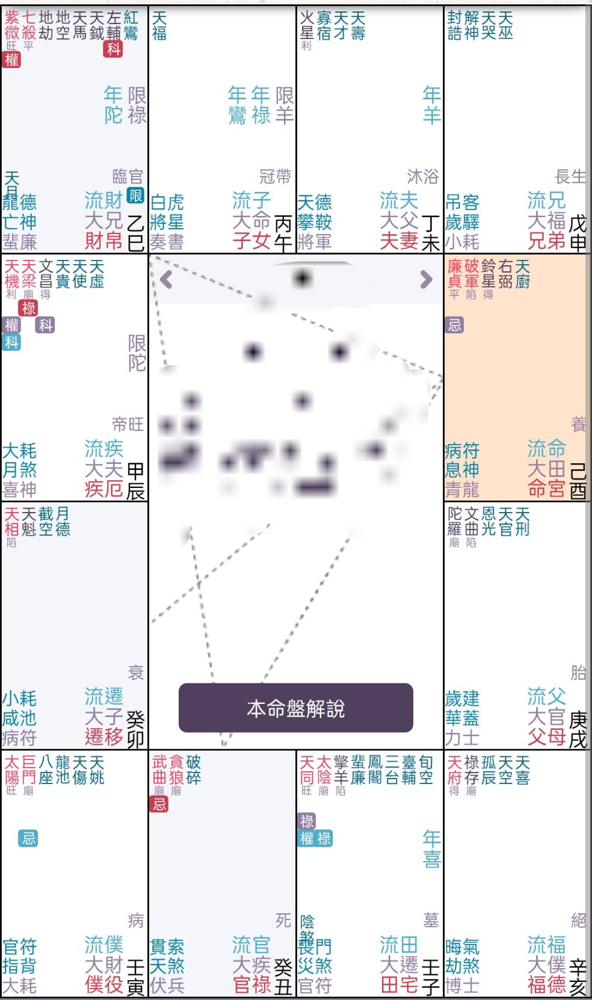

A car accident doesn't necessarily mean your body will be injured.
The best outcome is spending money to make the trouble go away (a financial loss or legal trouble is unavoidable).
But some traffic risks really do injure the body, and can even endanger life.
When bodily injury is involved, you must check the Parents–Body axis & the Self–Outer World, Money–Inner Life and Siblings–Friends palaces.
Today I'll use a case to teach you how to read traffic risks.

1\. Stars and palaces
Whenever these stars appear in particular palaces, there's a chance of a car accident during that period of the timing charts:
Stars related to car accidents: the Strategist (Tian Ji), the Star of Obscurity (Ju Men), the Keeper of the Seal (Tian Xiang), the Star of Depletion (Po Jun)
High-risk palaces: the Palace of Self and Palace of the Outer World, the Palace of Parents and Elders and Palace of Body and Health, the Palace of Children and Creation and Palace of Home and Property
(Pay special attention to the Palace of the Outer World and the Palace of Children and Creation, because they represent "the situation when you go out.")

2\. When is it likely to happen? Look at the "timing charts"
If your ten-year cycle chart and natal chart show the following combinations, and the same palace holds traffic-risk stars, please be more careful. For example:
ten-year Self–Outer World overlapping natal Parents–Body
ten-year Children–Home overlapping natal Parents–Body
ten-year Parents–Body overlapping natal Children–Home

3\. Timing
When the conditions above also come with the following, the traffic risk is higher:
1\. Sha stars added (Qing Yang, Tuo Luo, Huo Xing, Ling Xing)
2\. A traffic-risk star with Hua Ji (with the Star of Depletion, watch out for Hua Lu)
Several high-risk timings:
when the period's Heavenly Stem is Wu, Ding, Geng or Gui (for example, Western calendar years ending in 8, 7, 0 or 3)

4\. Case analysis
The ten-year Self–Outer World axis, overlapping the natal Partnership–Daily Focus axis, has Tian Ji and Ju Men facing each other across the axis; the ten-year Partnership–Daily Focus axis has the Sun and Moon facing each other.
This means that during these 10 years the chart owner puts weight on work, signs of job changes are strong, and they're also likely to be rushing around and on the move because of work.
Looking at these two axes alone, it actually isn't bad.
But it is in hidden combination with the most dangerous axis in the timing charts, Zi Wei–Po Jun with Tian Xiang (the ten-year Parents–Body axis overlapping the natal Siblings–Friends axis).
Checking the natal Parents–Body axis at the same time, it's the Wu Qu–Qi Sha axis, and the ten-year Children–Home axis adds a ten-year Qing Yang to it.
(It matches all the combinations of traffic-risk stars and palaces taught above; the ten-year Tuo Luo is in the Palace of Body and Health, and Qing Yang adds to the Palace of Children and Creation: full of Sha stars and Hua Ji.)

These combinations alone are enough that the chart owner must be reminded to be very careful about safety when out, especially traffic safety.
Although the ten-year Money–Inner Life axis has Tian Tong–Tian Liang, which could have offered protection, a way out of trouble and a buffer, unfortunately Di Kong and Di Jie face it from across the axis.

Pinpointing the time
Whenever the period runs through Ding, Ji, Gui, Jia or Geng, it makes the axis of the ten-year Parents–Body overlapping the natal Siblings–Friends (Tian Xiang with Wen Chang and Wen Qu – Zi Wei–Po Jun with Ling Xing) even worse.
When the annual chart lines up with the right palaces, it hits.
In 2023, the chart owner died in a car accident on the way to work.

Zi Wei Dou Shu isn't meant to create fear, but with a chart like this, you really do need to remind the chart owner:
during this ten-year cycle, going out, traffic, driving, riding in vehicles and rushing around for work all call for more care than for most people.
Especially when the annual or monthly charts set off the Parents–Body, Self–Outer World or Children–Home axes, avoid driving while tired, rushing, and long night journeys; also pay attention to the condition of the vehicle, and have insurance and emergency contacts in place.

We can't control other people, so let's do what we can.
& Do more good deeds to build up good fortune.
May all your misfortunes shrink from big to small, and from small to nothing.

<figure></figure>

