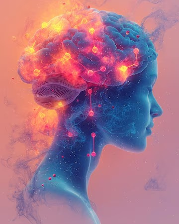

Falling in love with someone feels like suddenly having armor, and suddenly having a vulnerable spot.
We often think love is a resonance of souls, an arrangement of fate, but neuroscience tells us it's actually a chemistry experiment in the brain.

From the "ecstasy" of love at first sight to the "heartache" of a breakup,
this illusion is choreographed jointly by neurotransmitters, dopamine and hormones.
Love isn't the work of fate; it's your brain at play.

1\. The passionate stage: the brain's dopamine party
When you start falling for someone, the world instantly switches to "soft focus" mode.
You start daydreaming about them; just thinking of them makes your heart race,
and you can even spin their "read but no reply" into a romantic storyline.

Psychologists call this "passionate love,"
but neuroscientists would put it more bluntly:
"Your brain, right now, is in a state a bit like being on drugs."

Passionate love makes the ventral tegmental area (VTA) especially active,
the brain's center for processing "reward and motivation."
Eating dessert, having something icy, a cola, even taking drugs: it's all the same system at work.
The VTA releases dopamine, giving you "a little high," and then you tell yourself: "I want more!"
So you can't help wanting to repeat the behavior: seeing them, talking about them, sticking to them, fantasizing about them.
During this period, they look almost flawless in your eyes.

That's because neural activity in the "prefrontal cortex," which governs reason and judgment, drops (the thread of reason snaps).
What should have reminded you "they can't even be bothered to read your messages"
now makes excuses for them instead: "They must have been too busy to reply."
That's right: love is a brief illusion created by the brain.

2\. The attachment stage: love turns into a long run, held up by hormones
A few months later, the fireworks of dopamine fade, and the brain switches to
oxytocin and vasopressin.
They're called "pair-bonding hormones," responsible for conveying trust, attachment and a sense of security,
evolving you from a "romantic sprint" into a "steady relationship."
At this stage, the chemical makeup of love actually isn't much different from that of family love or friendship.
The same set of hormones also supports a mother's tenderness toward her child and the unspoken understanding between friends.
Oxytocin can also suppress stress hormones, so you feel "when I'm with them, my whole body relaxes."
And so "doing nothing" becomes the most romantic date.
Scrolling on your phones together, bingeing a show, a late-night snack: no more need for fireworks; the ordinary becomes the most moving.
"Security is the gentlest sedative in love."

However, when the prefrontal cortex (the center of reason and judgment) comes back online, you finally see that the person you once praised as "gentle, attentive and beautiful" is actually just slow, nagging, sloppy and fat.

Congratulations: the soft-focus lens is officially switched off.
The white rose is no longer a miracle, just a few grains of white rice dropped on the table.
From then on, love is no longer brilliant fireworks, just a return to everyday life.

3\. The heartbreak stage: hurting to the bone is real
When a relationship ends, the "heart" that hurts is actually your insular cortex acting up.
This part of the brain is responsible both for physical pain, like twisting an ankle or getting cut, and for psychological pain, the pain of "being rejected." So the bone-deep pain of a breakup isn't a metaphor; it's a real physiological phenomenon.

At this point you'll endlessly replay their photos and chat history, and even fantasize that they'll suddenly message you: "I still love you."
In fact, this is the VTA quietly switching on again: your brain hasn't yet learned to let go of that "sense of reward."

Don't worry, the prefrontal cortex will eventually come to the rescue and help you hit the brakes of reason.
Exercise, time with friends, listening to music: all of these can stimulate dopamine release again,
slowly helping you recover from the pangs of "quitting a person."

By the way, the adolescent brain isn't yet mature, so the first heartbreak feels like "the world is ending." But don't worry, that's just your brain's first breakup practice exercise.

4\. Zi Wei Dou Shu's romance radar
If you want to know whether a new romance is in your future, Zi Wei Dou Shu can also help you scan for "peach blossom signals."

1\. Check the Palace of Self, Palace of the Outer World, Palace of Love and Partnership and Palace of Daily Focus in the timing charts: at least one of them should have a peach blossom star (such as the Star of Depletion (Po Jun), the Blessing Star (Tian Tong), the Moon (Tai Yin), the Keeper of the Seal (Tian Xiang), the Star of Obscurity (Ju Men), the Seeker (Tan Lang), Wen Qu, Hong Luan or Tian Xi).
→ Having a peach blossom star means you also have the qualities that "make people like you."

2\. If the Palace of Love and Partnership in the timing charts has Hua Lu or Lu Cun, it means more romantic opportunities are coming.
→ Best of all is "a peach blossom star with Hua Lu"; the chances are higher.

3\. Most important of all: your real-life environment has to cooperate!
Even if your chart is full of peach blossom, if every day you "go straight home after work and stay in on weekends," and there isn't a single person of the opposite sex in your office, then the Prince Charming or Snow White of your destiny won't be able to find you.

In the next post, I'll teach you how to attract peach blossom!

<figure></figure>

