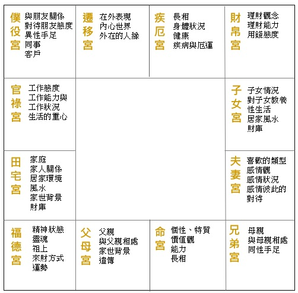

Feng shui isn't superstition. Its core is really this: through the design of space, adjust your physical and mental responses and patterns of behavior, and in turn change the direction of your fate.
A Zi Wei Dou Shu chart happens to provide each person with their own "map of behavioral habits."

※ How the chart maps to space
The 12 palaces of Zi Wei Dou Shu fall on the 12 Earthly Branches. The positions of the branches on the chart are fixed: starting from the Zi position, they run clockwise through Chou, Yin, Mao… all the way to Hai.
The Earthly Branches correspond to directions in space: Zi position = due north, Mao position = due east, Wu position = due south, You position = due west. (See the attached image.)

So we can use the position of a palace in the chart to find the Earthly Branch it falls on, map that to the direction in the space where you actually live, and then adjust the energy arrangement and design of that area, influencing the chart in return.

※ Can fate really be rewritten with "feng shui"?
Changing your fortune with feng shui? It doesn't rely on divine power! It relies on neural circuits.

Space affects how you feel, how you feel affects your behavior, and repeated behavior forms habitual neural pathways in the brain, which in turn shape the outcomes of your fate.

So changing your fortune with feng shui is really about changing your surroundings to alter the pathways underlying brain responses and behavior.

A professional Zi Wei Dou Shu practitioner can use your chart to find which palace has too many Sha stars and Hua Ji, which palace is the root of the problem, and which palaces hold "strengths," and then, combined with the principles of feng shui, make adjustments through furniture layout, placement of symbolic objects and ritual design.

※ Where the Sha stars land is often the source of behavioral blocks and poor decisions
The Sha stars in the chart (Huo Xing, Ling Xing, Qing Yang, Tuo Luo) usually symbolize strong raw emotions and reaction tendencies that are hard to put to good use.
When Sha stars and Hua Ji are concentrated in a palace during a period of the timing charts, especially Tuo Luo, it often means that area of life will show: procrastination, repetition, emotional self-depletion, stalled action, going around in circles, not knowing what to do, things not going smoothly.
In my experience, the direction in the chart owner's living space that corresponds to where Tuo Luo lands is often the spot at home piled with clutter, the messiest place, where the moment you sit down you don't feel like doing anything.

So keeping your home clean and tidy is the simplest way to change your fortune!

Example | The Palace of Daily Focus falls in the Mao position, with heavy Sha stars and Hua Ji
Suppose this year your Palace of Daily Focus in the timing charts falls in the Mao position (due east), and there are two Tuo Luo in the chart. This means you're prone to experiencing career setbacks, struggling to follow through, or doing poorly at school.
Remedy
1.	Find due east in your home (download a compass app on your phone)
2.	Light a candle or an oil lamp (Tuo Luo belongs to Metal, and Fire overcomes Metal)
3.	Every day when you light it, write down and silently recite your goal: "I'm going to focus on studying / finish the XX plan"
4.	Repeat the ritual of writing & reciting your goal → build neural pathways that start the behavior
This is a hands-on, three-in-one way of changing your fortune: ritual (psychological suggestion), combined with the chart (Zi Wei Dou Shu) and the memory of a place (spatial feng shui).

Example | The Palace of Money Management falls in the Wei position, with its stars in an auspicious state
Suppose this year your Palace of Money Management falls in the Wei position (south-southwest), and the stars are in good shape. This means you have the potential to break through in money and the use of resources, and make some money!
You can design ornaments or furniture arrangements in the south-southwest of your home that strengthen the energy of the major star:
every time you see them, it creates a psychological suggestion! Strengthening your wealth luck and your financial decision-making!

This isn't just feng shui; it's psychology (environmental cues) and behavior shaping.

Summary:
•	The Zi Wei Dou Shu chart helps you find your behavioral sticking points and your energy strengths
•	Mapping your living space to the chart lets the feng shui arrangement of that space adjust the chart in return
•	Ritual, psychological suggestion and the like, three in one, help you actually start changing your behavior

Truly effective feng shui is never about the supernatural; it makes space an ally of your fate,
completing a "designed intervention" in your fate through everyday arrangements and actions.

A practitioner's honest words:
90% of all bad outcomes have to do with your own personality, abilities, attitudes and values.
Feng shui isn't a miracle; it helps you adjust the [sufficient conditions] (remember the last post?) and adds a bit of psychological suggestion, so you stop repeating the same mistakes with the same behavior.

Feng shui masters charge so much not because they have magic powers, but so it costs you enough to hurt, and then you'll move.

People with strong enough willpower got moving on their own long ago; they don't need feng shui at all (they just need to confirm whether their decision is heading the right way XD).

Is changing your fortune hard? Of course! Otherwise where would all those failed dieters come from?

Another long post XD Not at all suited to the Threads algorithm. If you're seeing this, we must share a connection~

<figure></figure>

