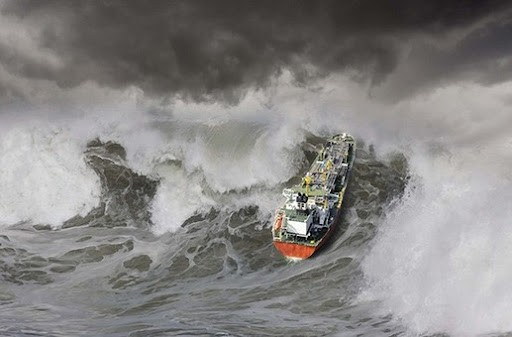
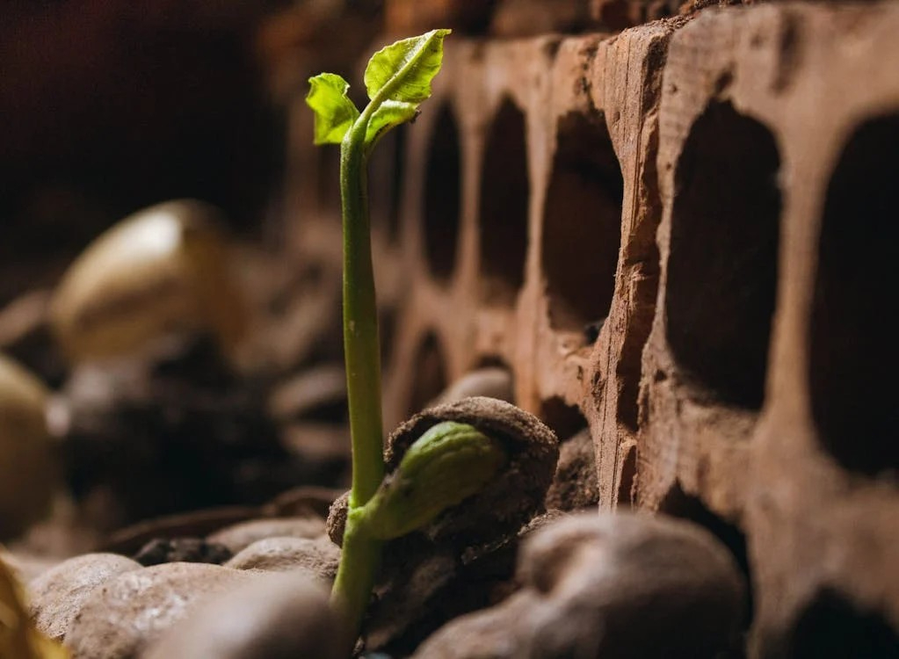

Life is sometimes like a taut string: it seems fine, but add just a little more pressure and the whole string may snap in an instant.
This phenomenon is exactly a concept that both psychology and engineering talk about: coupling with the environment.
"Coupling" was originally an engineering term, meaning two or more systems that are tightly linked and affect each other; when the coupling is strong enough, it sets off a chain reaction. The same logic applies to human behavior and emotional states.

1\. The threshold and the last straw
What often makes us break down emotionally or lose control of our behavior isn't the last thing that happened, but that thing becoming the threshold of the whole system: the straw that broke the camel's back.
For example: a normally mild-tempered person, under family disputes + money pressure + … multiple setbacks, finally erupts suddenly when an emotional misunderstanding piles on top.
Someone whose life was normal shows hard-to-reverse behavior after a series of blows, leaving people stunned.
None of this is "suddenly changing"; the inner pressure had long been building, and it took only a little bit more to set it off.

2\. Zi Wei Dou Shu: flying transformations
In Zi Wei Dou Shu, the operating logic of "flying transformations" is precisely another form of "coupling with the environment."
The palace's Heavenly Stem / the annual Heavenly Stem (the stimulus this environment gives you) → the Four Transformations acting on the stars in particular palaces (changing your behavior) → triggering the outcome

The environment (for example, the Heavenly Stem Yi of 2025) makes the stars in the palaces undergo the Four Transformations (the Guardian (Tian Liang) with Hua Quan, the Emperor (Zi Wei) with Hua Ke, the Moon (Tai Yin) with Hua Ji). When the palaces where these stars sit are, overall, carrying too many Sha stars and Hua Ji, environmental factors become the outside force that triggers events.
The palaces of the annual chart are the same for everyone, but the structure of the natal / ten-year charts each person's annual chart overlaps is different. So with the same annual Hua Ji and Sha stars, some people feel nothing, while for others it's one blow after another; some see small ripples, while others collapse entirely.
This is the difference in coupling with the environment: the same stimulus produces different reactions in different individuals.

For example: the Heavenly Stem of the annual Palace of Children and Creation causes a star in the Palace of the Outer World to take Hua Ji. If the Palace of the Outer World happens to overlap the ten-year or natal Palace of Body and Health or Palace of Inner Life and Fortune, and the palaces overall are full of Sha stars and Hua Ji, it means misfortune and bodily harm may happen when out in the world.
For instance, during the pandemic, some people came through safely, while for others, this outside environmental factor (Sha stars and Hua Ji) overlapped with the weak points in their ten-year or natal Palace of Body and Health or Palace of Inner Life and Fortune, leading to a blow to their health or mind.

Flying transformations + overlapping palaces with Sha stars and Hua Ji = coupling of an environmental stimulus + an individual weak point → an eruption at the threshold.
It only truly erupts when the coupling strength of stars, the Four Transformations, Sha stars and Hua Ji, palaces, and time and space exceeds the threshold.

3\. Behavior isn't determined by a single factor; it's triggered by coupling
Gladwell's book Talking to Strangers puts forward a similar view: depression may give people suicidal impulses, but it isn't enough to cause suicide. What actually leads to suicide is long-term depression + a stretch of bad weather + a convenient means of suicide; only when these three appear together do they form the coupling mechanism that "triggers action."

So to judge a person's behavior, you shouldn't look only at their personality and mental state, but also at the "overall environmental conditions" they're in at that moment.
This way of thinking is strikingly consistent with the interaction of "stars + palaces + conditions of time and space" that Zi Wei Dou Shu emphasizes when reading a chart.

4\. What coupling with the environment teaches us: one way to change your fortune is to "adjust your environment"
Psychology, behavioral science and Zi Wei Dou Shu stress this common point: it isn't your potential that determines everything about you, nor do outside events directly cause your fate; it's whether you and your environment "happen to line up," and the results set off once they're tightly coupled.

So: if you're at a low point, struggling or depressed, there's no need to rush to label yourself "a failure." You may simply be stuck in a period of strong coupling, with the threshold drawing near.
Get through it, and once the situation changes, your life will change along with it.

Understanding this helps us see better
why some disasters build up rather than strike out of nowhere;
why changing your fortune doesn't come from forcing yourself through, but from adjusting your environment and easing the strength of the coupling;
and how, in daily life, to "fine-tune your environment" to create a different path for yourself.

Fortune-telling calls it changing your fortune, psychology calls it shifting your mindset, engineering calls it adjusting system parameters.
In the end, they're all teaching us how to lower the pressure of coupling, avoid the threshold, and reshape the situation.
Adjust your environment, and you have a chance to change your behavior, and in turn change your outcomes and your fate.
This is the most important lesson that science and Zi Wei Dou Shu give us.

<figure></figure>

<figure></figure>

