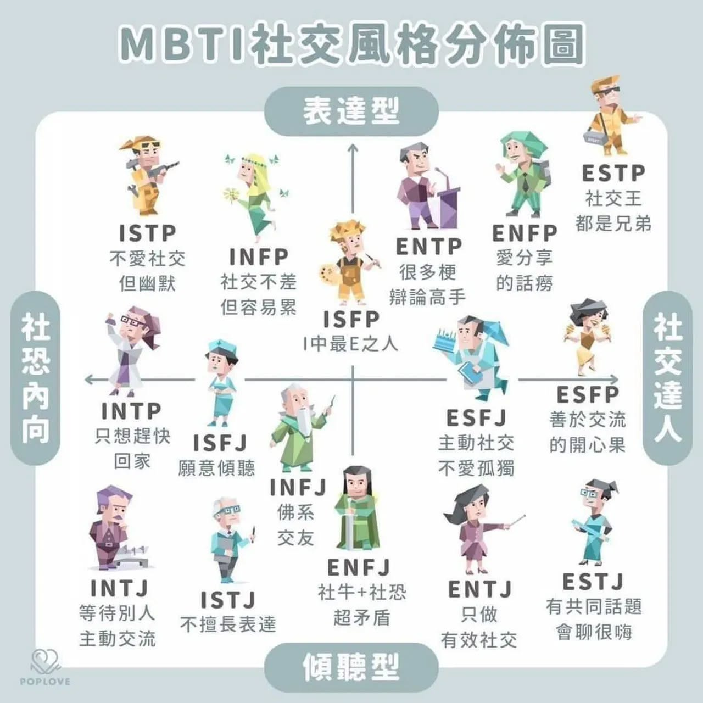

The Big Five personality analysis in psychology digs in deeply along five dimensions: openness (receptiveness to new things), conscientiousness (discipline & responsibility), extraversion (sociability), agreeableness, and neuroticism (emotional stability). It's just sometimes too "sharp"; after all, who wants to admit to being "neurotic and irresponsible"!
MBTI, with its four dichotomies (E extraversion / I introversion, S sensing / N intuition, T thinking / F feeling, J judging / P perceiving), is to some extent an incomplete substitute for the Big Five, SO it still has a certain accuracy. But MBTI leaves out the very important assessment of neuroticism (emotional stability), and that's exactly the factor that deeply affects people's decisions and behavior. Why is MBTI still so popular? Because of its "political correctness" and "human-friendly packaging," such as using "introverted" in place of "antisocial," and because it's light and easy to understand, it's widely welcomed in social circles.
Zi Wei Dou Shu was once reserved for imperial use. It blends Indian astrology, Ba Zi, Qi Men Dun Jia and other disciplines, and after spreading among ordinary people it took the Chinese-speaking world by storm. From the moment of your birth it generates a chart all your own; its 12 palaces paired with the stars clearly mark the signs at each stage of your life, from love to health, telling you when good things will happen and when you'll meet challenges. It's like a "map of life," offering deep and detailed guidance. But because it's so mysterious, master practitioners rarely pass it on, and it's hard to verify with modern science, so using it rationally is the way to go.
The point isn't which is most accurate; anything that helps you understand yourself, make the most of your strengths, and seek the good and avoid the bad is a good tool!

<figure></figure>

