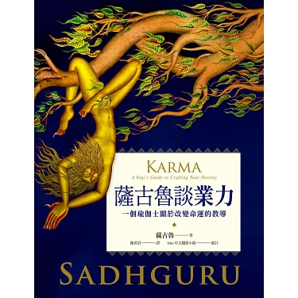

"It's all fate." The older generation loves to say this.

Domestic violence, and you can't get away: fate!

Things going badly at work, badly in love: fate!

When Chen Hsing-yu and Chao Chien-ming were recently all over the news and the whole of Taiwan was following the drama, some people said it was karma: debts owed in a past life, being repaid in this one.

The Indian yogi Sadhguru says: karma isn't heaven setting you a test, nor is it about who owed whom in a past life.

Karma is a blueprint for your life that you create through your actions (and note, not only physical actions), and this blueprint will shape your destiny.

There is no judge, no scorecard, no "god" arranging your fate.

**Your destiny is of your own making.**

The point isn't who is punishing you, but that our repeated reactions and choices also shape the rest of our lives, little by little.

Sadhguru says karma is a blueprint you write yourself. So does Zi Wei Dou Shu have a way to find where your karma lies? It does!

## Tuo Luo in the natal chart

Zi Wei Dou Shu borrows the Buddhist idea of karmic obstacles to describe this: the palace where Tuo Luo sits in your natal chart is where karma from a past life remains unresolved, and also where your lessons in this life lie. It is like the place in a person's life where they are especially prone to getting entangled again and again, or find it hard to let go.

If you accept the language of reincarnation, you can call it "unfinished business from a past life";

if you take the religious language away, you can also understand it as "a knot life keeps asking you to untie."

The key words for Tuo Luo are vivid: spinning in place, having no direction, being prone to wrong decisions, entanglement, being unwilling or unable to let go.

Like a spinning top, turning and turning on the same spot.

Taken apart, the mechanism of Tuo Luo works like this:

**Something happens → you can't cleanly walk away → it keeps pulling at your mind → you keep going back → you're stuck.**

Everyone has been through it. A relationship is clearly wrong, you know it in your heart, but something keeps pulling you in: maybe love, maybe guilt, maybe just not being willing to accept it, or fear of being alone.

It's the same at work: it's obviously time to leave, but you keep feeling you should hold on a little longer, wait a little more.

Investing too: chasing at the top, selling at the bottom, to follow or not to follow, until you're trapped, unable to get your money back and unable to walk away.

So whichever palace Tuo Luo is in shows an area where you have an especially hard-to-release "knot," or a relationship you can't cut off.

With Tuo Luo in the Palace of Love and Partnership, you easily get entangled in relationships;

with Tuo Luo in the Palace of Money Management, money easily gets stuck;

with Tuo Luo in the Palace of Daily Focus, you keep hesitating in your career.

It isn't that you can't leave; it's that inside there's too much you haven't worked out, can't put down, can't bear to give up.

But let's take away the religious framing.

Don't think of where Tuo Luo sits as "what karma I created in a past life"; see it instead as "a knot we want to understand and untie."

This shift is crucial.

"Karmic obstacles" sounds like something passively endured: whatever you did in your last life, you have to repay in this one.

But a "knot" is active: you can choose to understand it and untie it, or you can keep letting it entangle you.

And here's the most interesting thing about Tuo Luo: **the same force, misused, means "being stuck"; used well, it means "holding steady."**

So how can you tell whether you're "holding steady" right now, or just "stuck"?

Sadhguru's explanation of karma actually offers a very useful angle.

He holds that karma isn't a test heaven has set for you, but a pattern that slowly forms in you through your actions, thoughts and emotional reactions, again and again:

a stimulus appears, and you react;

repeat the same reaction long enough, and it becomes a tendency;

keep the tendency long enough, and it becomes your character;

as that character hardens, it looks more and more like "this is just the kind of person I am."

The most troublesome part is that when you automatically react the same way every time something similar happens, you're actually using today's choices to keep training tomorrow's self.

So you meet the same kind of relationship again and again;

the same kind of mistake happens again and again;

you get stuck in the same place again and again.

You think, "Why is it me again?"

But looked at another way, it may be that you keep using the same pattern and walking back to the same place.

Sadhguru holds that if we let our momentary emotions, impulses and habits carry us along, we keep accumulating similar karma; what can truly change the loop is a little more "conscious choice" before we react.

This is actually a lot like Tuo Luo.

Tuo Luo is like a top that never stops spinning. The question isn't whether it's moving, but **after spinning for so long, has it ever left the starting point?**

So the real question may not be "Should I let go or not?"

but "Am I choosing again right now, or repeating the same pattern?"

If every time a relationship runs into trouble, you handle it the same way;

if every time work goes badly, you tell yourself, "Just put up with it a little longer";

if every time an investment loses money, you keep adding to it because you can't accept the loss,

then even if the people are different, the companies are different and the investments are different, underneath it may still be the same you, making the same kind of reaction. "Not letting go" at a time like this is closer to Tuo Luo being stuck.

But resilience isn't like that. Resilience isn't refusing to change no matter what.

Real resilience is this:

I can keep going, but I'll watch the results; if the method isn't working, I'll adjust it; if conditions change, I'll reassess; when new information comes in, I'll allow myself to revise my original decision.

**What I hold on to is "what I want to accomplish," not "the way I originally planned to do it."**

Obsession, on the other hand, is more like this: no matter what the results are, no matter how high the cost has become, no matter what new information tells me, in the end the answer is always the same: "I just can't let go."

So Tuo Luo's lesson may never have been "learning to let go."

Some things really are worth holding on to for ten years.

What you really need to learn is whether, inside that endlessly spinning top, you can slowly make a little more room for choice.

The next time you're stuck in the same place again, ask yourself:

**Do I truly want to stay, or have I been carried back to the starting point by the same pattern once more?**

---

Where are your "karmic obstacles from a past life"? Is this life really that painful? Feel free to share.
